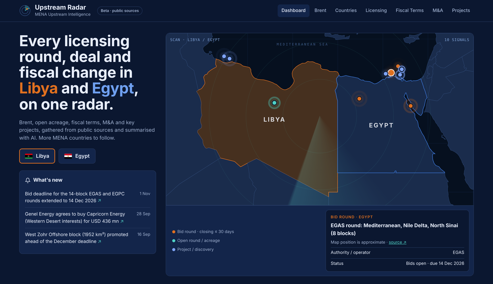
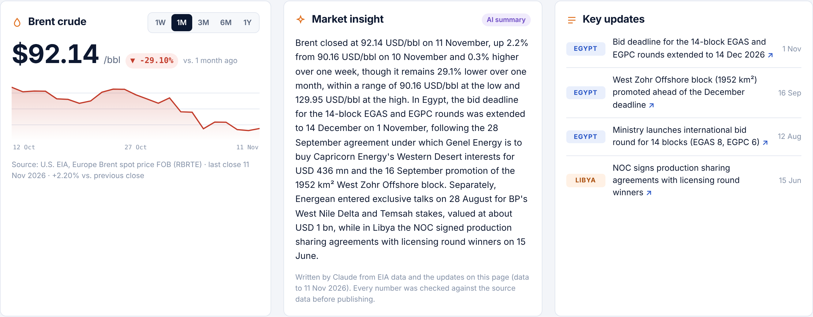
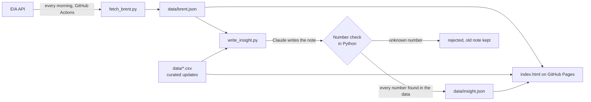

# Upstream Radar

**MENA upstream oil & gas intelligence for Libya and Egypt — Brent, licensing rounds, fiscal terms, M&A and key projects on one radar.**

🔗 **Live site:** https://mugealb.github.io/upstream-radar/

## Why

Licensing rounds, deal news and fiscal terms for North African upstream are scattered across ministry websites, NOC announcements, law-firm briefings and trade press. Upstream Radar brings them into one page, with a source link behind every line, so an analyst can see in a minute what is open, what is closing and what has changed.

## What it shows

| Module | What you get | Source |
|---|---|---|
| **Brent crude** | Daily Brent spot price, 1W to 1Y chart | U.S. EIA API (series RBRTE), updated automatically every morning |
| **Market insight** | A short daily note written by AI | Claude, from the EIA data and the updates on the page |
| **Radar map** | Open bid rounds, open acreage and key projects; bid rounds turn orange when 30 days or fewer remain | `data/signals.csv`, `data/projects.csv` |
| **Licensing & auctions** | Open rounds with a live countdown to the bid deadline | EGAS, EGPC, NOC announcements |
| **Fiscal terms explorer** | Libya (EPSA) vs Egypt (concession / PSC): royalty, tax, cost recovery, profit split, state participation | Law-firm and industry publications, linked per line |
| **M&A and project tracker** | Asset deals and field status | Company releases and trade press, linked per line |

## How it works

- **No server.** The site is a single HTML page on GitHub Pages. A scheduled GitHub Action fetches Brent and writes the AI note each morning.
- **AI writes, Python checks.** Claude only writes the words. Every number in its note must already appear in the data computed in Python; if not, the note is rejected and yesterday's stays online.
- **Curated data in plain CSV.** Licensing rounds, deals, projects and fiscal terms live in `data/*.csv`. Adding a row on GitHub updates the map and the cards within minutes.
- **Keys stay secret.** The EIA and Anthropic API keys are stored as GitHub Actions secrets and never appear in the code.

## Data rules

1. Public sources only. Every row carries a source link.
2. Fiscal terms are summaries of public legal and industry sources. Actual terms differ by block and are negotiated contract by contract.
3. Map positions are approximate; bid rounds do not publish block coordinates.
4. Not investment advice.

## Tech

HTML, CSS, JavaScript · Python · GitHub Actions · GitHub Pages · EIA Open Data API · Claude API

---

### Türkçe özet

Upstream Radar, Libya ve Mısır'daki upstream petrol ve gaz gelişmelerini tek ekranda toplayan bir istihbarat panosu: Brent fiyatı, açık ihaleler ve son başvuru geri sayımı, fiscal terms karşılaştırması, M&A ve proje takibi. Brent her sabah EIA'dan otomatik çekiliyor; günlük piyasa notunu Claude yazıyor ve nottaki her rakam Python ile veriye karşı kontrol ediliyor. Tüm veriler herkese açık kaynaklardan, her satırda kaynak linkiyle.

*A personal project by Müge Albut. Also see [FeasibilityAI](https://github.com/mugealb/feasibility-ai).*
